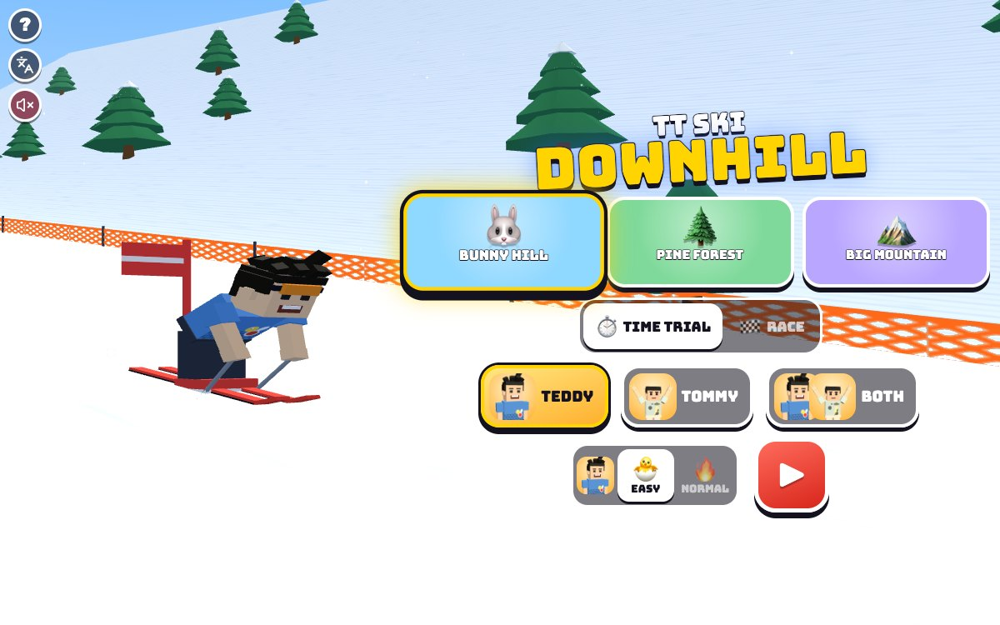

# TT Ski Downhill

Press **?** any time (or tap the round **?** button in the top left corner) to see the keys. The game waits while you look.
Tap the language button under it (the A文 icon) to switch between English and 中文; the dashboard and every game remember the choice.

**中文：** 滑雪：从雪山上一路滑下来，穿过红蓝旗门，飞过跳台，颠过雪包，绕开雪人。可以自己计时，也可以和狐狸、青蛙比赛，或者兄弟俩一起比。

A downhill slalom for Teddy and Tommy. Ski down a snowy mountain between the red and blue gates, fly off the snow ramps, bounce over the moguls and dodge the friendly snowmen to the finish arch. Ski against the clock in a **time trial**, or **race** Foxy 🦊 and Froggy 🐸, or race each other on a split screen. Three slopes, two levels, and the other brother always ready to swoop in for a speed tuck.

It's built with Claude Code from plain JavaScript and Three.js, in the same style as Metro Surfer and the other Teddy & Tommy games. There are no image, model or audio files: the mountain, trees, gates and snowmen are boxes, cones and canvas textures, Teddy and Tommy come from the shared kit (`kit/`), and every sound is synthesised.

The name lives in one place, [js/title.js](js/title.js). "TT Ski Downhill" is a working title until Alan names it.

## Play

- **Double-click `index.html`.** It works offline, because Three.js and the kit are copied into `kit/`. Without internet the logo falls back from the Bungee font to Arial Black.
- **Send one file:** `dist/ski-tt.html` is the whole game in one file. AirDrop or email it, then open it in a browser.
- **Rebuild that file** after any edit: `python3 kit/tools/bundle.py . --name ski-tt`
- **Get kit updates** from `~/claude-games/kit`: `python3 ../kit/tools/sync.py .`, then rebuild.
- **On the home screen** pick a slope, ⏱️ TIME TRIAL or 🏁 RACE, who skis (TEDDY, TOMMY or BOTH), 🐣 EASY or 🔥 NORMAL for each brother, then ▶. Behind the menu the chosen boy skis the chosen slope, round and round.
- **Each run** starts in the start gate with 3, 2, 1, GO! The clock starts on GO and stops when you cross the finish line, plus any penalty seconds. A run takes about half a minute on Bunny Hill and under a minute on Big Mountain.
- **The end:** the winner does his signature move facing you (Teddy's boxing combo, then his 🏀 jump shot; Tommy's Y with peace fingers ✌️) while confetti flies, then the results: 🥇 🥈 🥉, everyone's time and missed gates, NEW BEST! when you beat your best. 🔁 skis again, ⏭️ goes to the next slope, 🏠 back home.
- **Saved per browser:** the slope, the mode, who skis, each brother's level, the best time on every slope at each level, and each brother's 🏆 wins (shown on his button). `index.html` and `dist/ski-tt.html` each keep their own, because they're different ways of opening the game.

### The slopes

| Slope | Length | Gates | Ramps | Moguls | Snowmen |
|---|---|---|---|---|---|
| 🐰 Bunny Hill | 480 m | 10 | 1 | none | 3 |
| 🌲 Pine Forest | 640 m | 15 | 2 | 1 field | 5 |
| 🏔️ Big Mountain (at sunset) | 800 m | 22 | 3 | 2 fields | 7 |

Each slope is made from a seed in [js/courses.js](js/courses.js), so it's the same every time. Orange nets line both sides, with snowy pine forest beyond and mountains far down the valley.

### Gates, ramps and moguls

- **Gates (旗门):** ski between the two flags. A gate you pass wiggles and goes gold with a ding; a missed gate goes grey and adds seconds to your time. Each gate is judged once, where you cross it.
- **Ramps (跳台):** a ramp throws you in the air. Press jump in the air for a trick (a spin, with Teddy's jump shot or Tommy's Y), and land it for a speed boost: TRICK! ZOOM!
- **Moguls:** bumpy fields that bounce you about and slow you a little. Jump on the snow for a little hop over them.
- **Snowmen and the nets:** BONK! They slow you down, but nothing ever stops you for good.
- **Tuck:** hold it to crouch down low and go faster, but you turn less.

### Time trial and race

- **⏱️ TIME TRIAL:** just you and the clock (with BOTH: the two brothers side by side, each with his own clock; fastest time wins).
- **🏁 RACE:** you against Foxy 🦊 and Froggy 🐸 (with BOTH: the two brothers and the two of them). Places go by time, penalties included.
- **2 players:** split screen, side by side on a wide screen, one above the other on a tall one. Each brother picks his own level. The one behind gets a little catch-up push, so races stay close.

### Levels

| | 🐣 EASY (Tommy, 5) | 🔥 NORMAL (Teddy, 8) |
|---|---|---|
| Speed | 15 m/s, 19 tucked | 19 m/s, 25 tucked |
| Steering help | points you at the next gate whenever you let go | none |
| A gate counts | up to 1.5 m outside the flags | between the flags |
| Missed gate | +1 s | +3 s |
| Foxy and Froggy | slower, and they wait for you (your penalty seconds count) | a real race: tuck and ski clean to win |

## Controls

| | 1 player | Teddy (2 players, left) | Tommy (2 players, right) |
|---|---|---|---|
| Steer | A D or ← → | A D | ← → |
| Tuck (hold) | S or ↓ | S | ↓ |
| Jump · trick in the air | Space, W or ↑ | W or Space | ↑ or Enter |
| Call your brother · high five | T | T | T |
| Pause | P or Esc | | |
| Sound on / off | M | | |

- **Home screen:** A D or ← → pick a slope, W S or ↑ ↓ pick the level (with BOTH, W S for Teddy, ↑ ↓ for Tommy), 1 2 3 pick who skis, R switches time trial / race, Enter or Space starts. On the results, Enter skis again, N goes to the next slope, Esc or H goes home.
- **Touch:** hold ◀ ▶ to steer, hold ⬇ to tuck, tap ⬆ to jump, each brother with his own set in his half of the screen. Tap your brother's face (or ✋ with two players) at the bottom.
- **The ? panel, the language button and the speaker** sit in a column in the top left corner, away from the touch buttons.

## Companion

- **Call your brother any time, as often as you like:** press T or tap his face at the bottom of the screen (Kit.roster.buddyFor picks him: Tommy for Teddy, Teddy for Tommy).
- He pops up on skis beside you at his buddy size, turns round to face you and does his signature move: Tommy's Y ✌️, or Teddy's boxing and 🏀 jump shot.
- He tosses you a treat (🍦 💧 🧃 🍪 🍉 🍌): "🍪 COOKIE FROM TOMMY!"
- Then his helper, the **speed tuck**: "TOMMY SAYS: TUCK AND ZOOM!" Both of you crouch into a tuck and zoom for 5 seconds, faster than your best tuck and with full steering, with speed lines on the screen. Then he waves and pops off in a puff of snow. Call him again whenever you like.
- **With two players,** T (or the ✋ button) is a high five: both brothers hold out a hand, and both get a little boost.

## How it was checked

- **`node tools/check.js`** (about 2 seconds), the same checks as `game.check()` in the page ([js/checks.js](js/checks.js)). Whole races are skied by pretend players (do nothing, a careful 8-year-old, a wobbly 5-year-old, mashing random keys):
  - **finishable:** 144 races, every slope, both levels, solo, race and 2 players: everyone gets down, every gate is judged, nobody leaves the course, the longest run is 78 s. A careful skier gets down every slope through every gate without a bonk, so no gate is out of reach.
  - **gates:** a skier going dead straight 1 cm inside the edge passes and 1 cm outside misses (EASY's 1.5 m extra included), on every slope and level; skipping one gate misses exactly that gate, once, and adds exactly its penalty; Foxy and Froggy ski clean.
  - **timing:** the same races at 30, 60 and 144 frames a second and at a jumpy frame rate give identical times; the finish is timed inside the 1/120 s step where the line is crossed; time = finish + penalties; places go by time; nobody moves in the count-in; the clock shows hundredths, cut not rounded.
  - **easyRace:** on EASY the wobbly 5-year-old beats Foxy and Froggy on every slope (5 seeds each); on NORMAL a careful skier wins and doing nothing loses.
  - **Each check is broken on purpose** and has to notice: a fence across the course, a gate swung out of reach, every gate passed, no penalties, a gate counted twice, the finish stamped at the end of the frame, the clock started in the count-in, and CPUs 25% faster. All eight are caught.
- **In the browser** (muted): races on every slope, both levels, 1 player and 2, the brother's visit (treat, speed tuck), pause, the finish and the results, through `game.step()`. 中文: every screen visited with `Kit.lang.untranslated()` returning [], and the toasts' rules checked one by one. English: no Chinese on the page except the kit's language button tooltip. No console errors.
- **Layouts** in headless Chrome (`node tools/shoot.js tools/shots-tour.json <dir> <width> <height> 1`): phone portrait 390x844, phone landscape 740x360, iPad 1024x768 and 820x1180. `docs/screenshot.jpg` is the title screen at 1200x750 (`node tools/shoot.js tools/shots.json docs 1200 750`).

## Files

- [index.html](index.html): the page, its styles and the menus.
- [js/title.js](js/title.js): the name.
- [js/courses.js](js/courses.js): the three slopes (gates, ramps, moguls, snowmen) and the snow's height.
- [js/ski.js](js/ski.js): the race rules with no drawing: steering, speed, jumps, gates, timing, Foxy and Froggy, the pretend players.
- [js/checks.js](js/checks.js), [tools/check.js](tools/check.js): the headless checks.
- [js/world.js](js/world.js): the 3D slope, sky, trees, gates, ramps, snowmen, start and finish, snow and sparkles.
- [js/skier.js](js/skier.js): the skiers (the kit's boys on skis, Foxy and Froggy), their stance, tricks and celebrations.
- [js/game.js](js/game.js): the game: home, count-in, controls, cameras, the brother's visit, the HUD, results.
- [js/keys.js](js/keys.js), [js/zh.js](js/zh.js): the ? panel and the 中文 words.
- [tools/shoot.js](tools/shoot.js): screenshots with headless Chrome.

## Not verified

- **Sound:** every test ran muted, so none of it has been heard; the sounds are checked in code only.
- **Real touch devices:** an iPhone or iPad, iOS Safari, two kids holding buttons at once on one iPad, and the iPad's frame rate with the split screen (it draws the slope twice).
- **Real kids:** whether EASY is easy enough for Tommy, whether NORMAL is a good race for Teddy, and whether a minute on Big Mountain is too long.
- **The iPad home-screen icon** (⛷️ on ice blue) and double-click from Finder.
